# 第 10 章 实验结果与汇总

本章给出三个场景（悬停、正方形、8 字）× 四个源（目标、offboard 实飞、模型预测控制（MPC）仿真、模型预测控制实飞）的图与指标，并单列能比到哪一层、哪些事还没验证。口径见第 9 章；图与表由脚本从 `docs/report/data/` 与 `tools/report/evidence/sitl/` 现算，正文不手抄结果数，也不给总评式的过关结论。

---

## 10.1 读数口径

### 10.1.1 公共窗与各源完成时刻

四个源先各自回到 `/traj/start` 时间零点与轨迹原点，再切到公共窗 `[0, min(各源完成时刻)]`。表 10-1 给出网格点数、公共窗与各源完成时刻。

**表 10-1　三场景的公共窗与各源完成时刻**

<!-- BEGIN phase5-metrics:window -->
| 场景 | 网格点/源 | 公共窗 (s) | target 完成 (s) | offboard 完成 (s) | mpc_sim 完成 (s) | mpc_real 完成 (s) | 右端由谁决定 |
|---|---|---|---|---|---|---|---|
| 悬停 | 3966 | 0 – 39.6494 | 39.6501（ref_end） | 39.6501（ref_end） | 39.6494（ref_end） | 60.0163（progress） | mpc_sim = 39.649415 s |
| 正方形 | 802 | 0 – 8.0096 | 8.0213（progress） | 8.0213（progress） | 17.8923（ref_end） | 8.0096（progress） | mpc_real = 8.009599 s |
| 8 字 | 1222 | 0 – 12.2021 | 12.2130（progress） | 12.2130（progress） | 26.2338（ref_end） | 12.2021（progress） | mpc_real = 12.202111 s |
<!-- END phase5-metrics:window -->

表注：取自 `data/<scene>.json` 的 `grid` 与 `sources`；`progress` 为首个 `/traj/progress ≥ 1.0`，`ref_end` 为参考流末帧。仿真时间是 SITL 自己的时间线，不能与墙钟相减。悬停 offboard 包在参考流末尾被录制截断，`progress` 终值 0.661，不是控制失败。

<big>**一句话总结：四源先对齐时间零点与轨迹原点，再切到各源完成时刻的最小值；悬停窗口停在 offboard 包的录制截断处。**</big>

### 10.1.2 图与表的生成方式

图来自 `plot_traj.py`、`plot_attitude.py`、`plot_error.py`、`plot_control.py`，只读 `docs/report/data/*.csv`，图注读同名 `.json` 并写入 `figure-captions.md` 的分块。表由 `report_metrics.py` 现算到 `generated/metrics.md`，同一份块写进本章的 `phase5-metrics:*`；脚本逐项与 JSON 的 `metrics_vs_target` 对账，对不上就报错。重跑 `build.py --scene all` 与 `report_metrics.py`，表随数据更新。

<big>**一句话总结：图与表都由脚本从 CSV、JSON 与求解摘要现算，正文只解释方向，不手抄结果数。**</big>

---

## 10.2 轨迹图（T1–T3）

三张轨迹图都是左 XY 俯视、右 Z–t，四源叠加；目标虚线，实际源实线。XY 等比例同刻度，悬停因此缩成一个点，不是轨迹丢失。

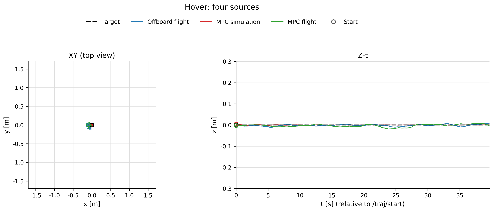

**图 10-1　悬停：四源轨迹。** 场景：悬停；窗口：表 10-1 的悬停公共窗。来源：目标与 offboard 来自 `bag/3_traj1_hover`，仿真来自 `R-hover`，实飞来自 `bag/6_free__20261017-070103`。生成：`python3 tools/report/plot_traj.py --scene all`。

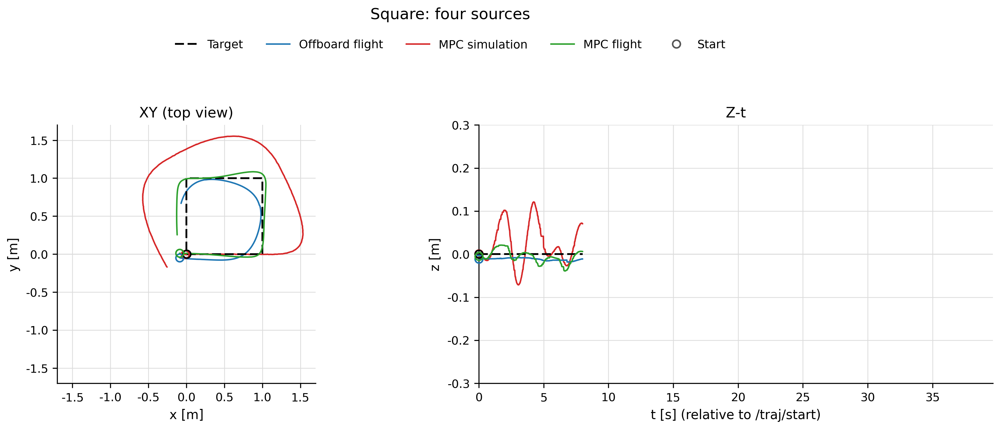

**图 10-2　正方形：四源轨迹。** 场景：正方形；窗口：表 10-1 的正方形公共窗。来源：目标与 offboard 来自 `bag/4_traj2_square`，仿真来自 `R-square`，实飞来自 `bag/6_free__20261017-070446`。生成：`python3 tools/report/plot_traj.py --scene all`。

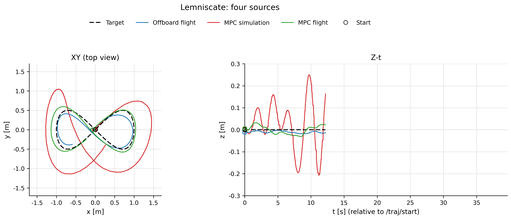

**图 10-3　8 字：四源轨迹。** 场景：8 字；窗口：表 10-1 的 8 字公共窗。来源：目标与 offboard 来自 `bag/5_traj3_lemniscate`，仿真来自 `R-lemniscate`，实飞来自 `bag/6_free__20261017-070935`。生成：`python3 tools/report/plot_traj.py --scene all`。

<big>**一句话总结：三张轨迹图里实飞两源都跟住了形状，仿真的拐角外扩与高度起伏最大；逐点差别由误差图表给出。**</big>

---

## 10.3 姿态图（A1–A3）

姿态图每张三行：roll、pitch、yaw（deg），四源叠加。目标为控制器约定的“水平 + 纯偏航”，故三行目标线均为 0。

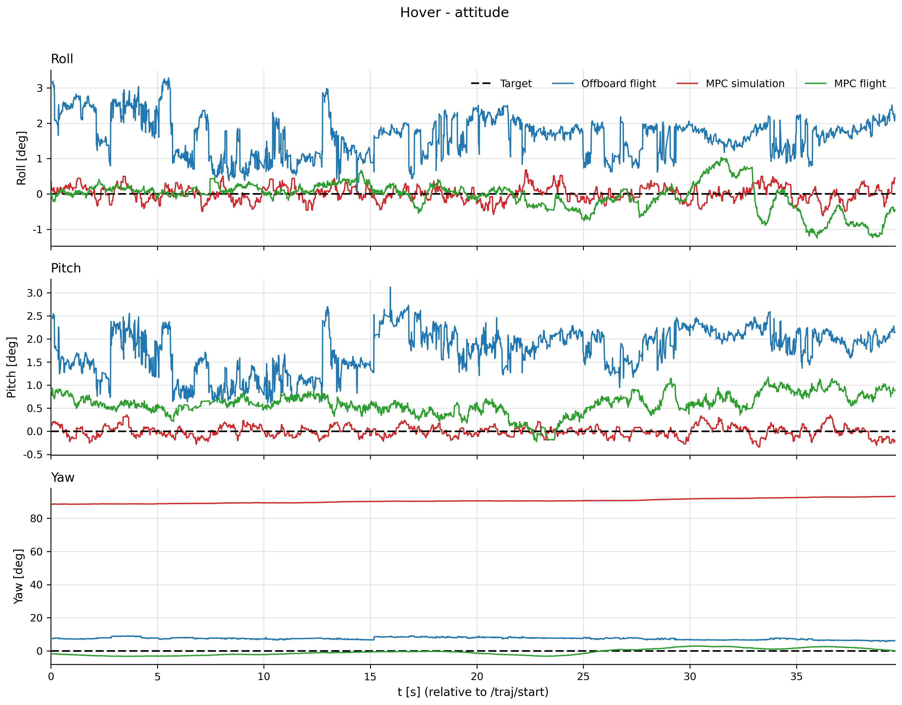

**图 10-4　悬停：四源姿态角。** 场景：悬停；窗口：表 10-1 的悬停公共窗。来源：实飞姿态取 `/mavros/vision_pose/pose`，仿真姿态取 `x0[6:10]` 四元数，目标为常量 0。生成：`python3 tools/report/plot_attitude.py --scene all`。

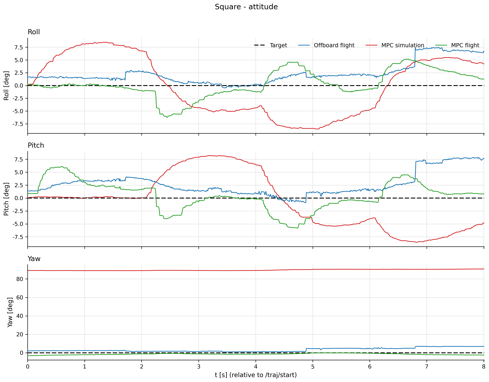

**图 10-5　正方形：四源姿态角。** 场景：正方形；窗口：表 10-1 的正方形公共窗。来源与生成命令同图 10-4。

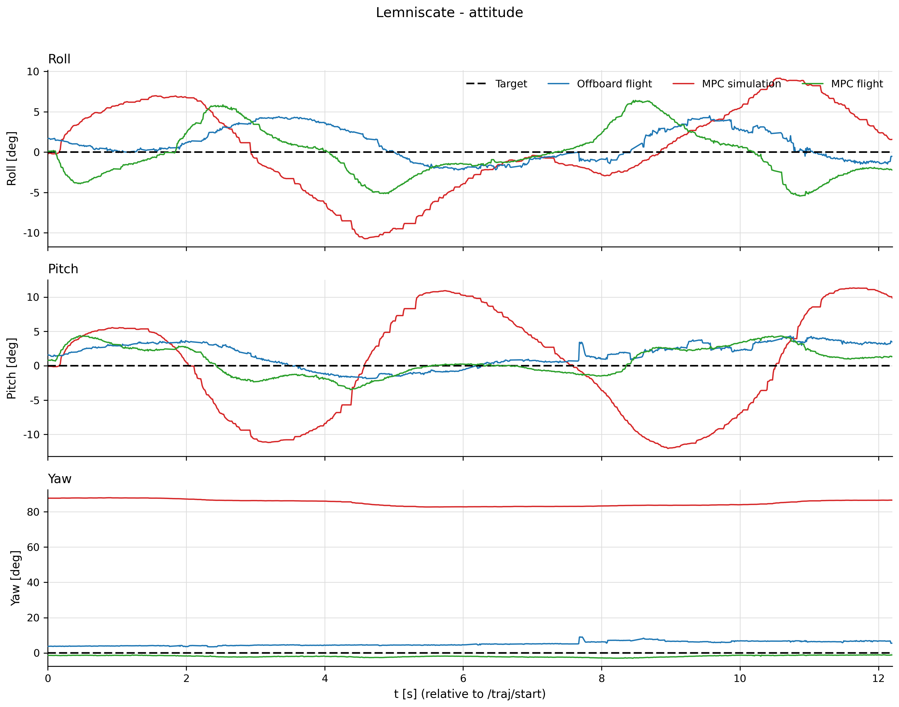

**图 10-6　8 字：四源姿态角。** 场景：8 字；窗口：表 10-1 的 8 字公共窗。来源与生成命令同图 10-4。

实飞 roll 带约 +0.03 rad 的 VP/EKF 零点差，图与表 10-2 均**未扣**，判断滚转控制前按 9.6.4 先扣。仿真 yaw 整场在 90° 附近，是真实读数，原因尚未判定，不要当控制失败扣掉。表 10-2 把总夹角拆成倾角与偏航差；仿真源的总夹角几乎全由偏航差贡献。

**表 10-2　姿态误差（相对目标：水平 + 纯偏航）**

<!-- BEGIN phase5-metrics:attitude -->
| 场景 | 源 | 总夹角均值 (°) | 总夹角最大 (°) | 倾角均值 (°) | 倾角最大 (°) | 偏航差均值 (°) | 偏航差最大 (°) |
|---|---|---|---|---|---|---|---|
| 悬停 | offboard | 7.87 | 9.77 | 2.43 | 4.03 | 7.48 | 9.09 |
| 悬停 | mpc_sim | 90.51 | 93.27 | 0.21 | 0.69 | 90.51 | 93.26 |
| 悬停 | mpc_real | 2.01 | 3.35 | 0.71 | 1.56 | 1.81 | 3.28 |
| 正方形 | offboard | 5.02 | 12.35 | 3.73 | 10.42 | 3.25 | 7.12 |
| 正方形 | mpc_sim | 90.05 | 91.25 | 7.66 | 9.83 | 89.71 | 90.84 |
| 正方形 | mpc_real | 3.69 | 7.47 | 3.25 | 7.42 | 1.41 | 3.09 |
| 8 字 | offboard | 6.15 | 9.78 | 3.02 | 5.63 | 5.25 | 9.09 |
| 8 字 | mpc_sim | 85.48 | 87.96 | 8.91 | 12.94 | 85.08 | 87.95 |
| 8 字 | mpc_real | 3.97 | 7.18 | 3.34 | 6.68 | 1.90 | 3.02 |
<!-- END phase5-metrics:attitude -->

表注：窗口为表 10-1 的公共窗；姿态误差取四元数最小旋转角，倾角去掉偏航，偏航差 wrap 到 $[-\pi,\pi]$。实飞为 VP，仿真为 `x0[6:10]`，测量源不同，差值不能全归给控制器。

逐源的 pitch/roll 细节另有一组 9 张图（`docs/report/figures/fig-pitchroll-<scene>-<source>.png`），本章不重复展开。

<big>**一句话总结：实飞机头基本保持，倾角随机动增大；仿真的偏航差整场约九十度，这一读数的原因尚未判定。**</big>

---

## 10.4 位置误差（E1–E3）

### 10.4.1 误差–时间图

误差 = 实际 − 目标，三个分量各一行；目标行恒为 0，只标零误差位置，不是第四条实际轨迹。

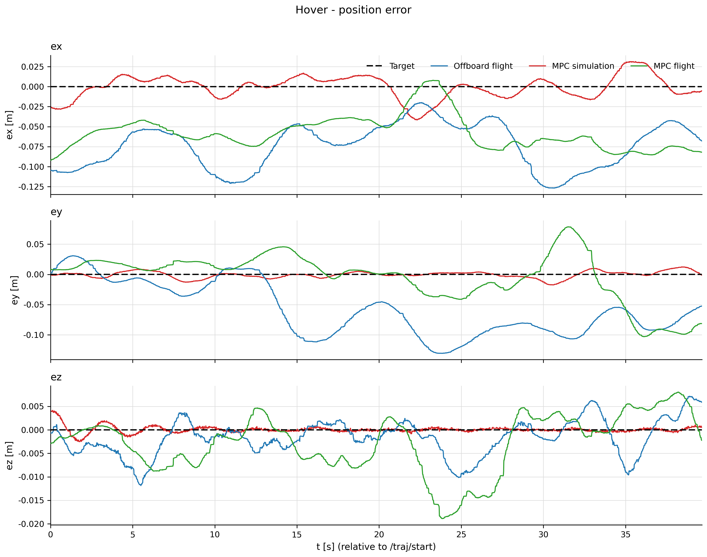

**图 10-7　悬停：位置误差–时间。** 场景：悬停；窗口：表 10-1 的悬停公共窗。来源：实飞为 VP，仿真为 `x0` 位置，误差 = 实际 − 目标，轨迹原点相对系。生成：`python3 tools/report/plot_error.py --scene all`。

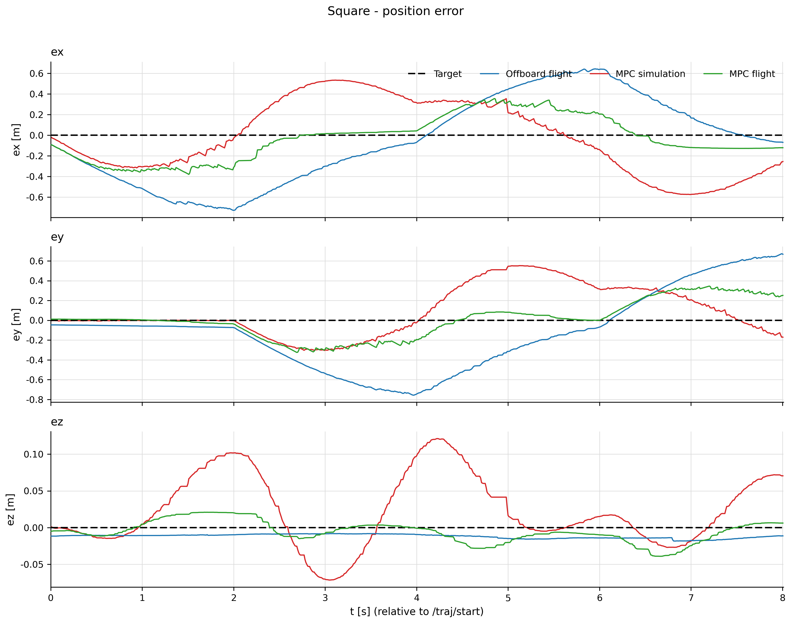

**图 10-8　正方形：位置误差–时间。** 场景：正方形；窗口：表 10-1 的正方形公共窗。来源与生成命令同图 10-7。

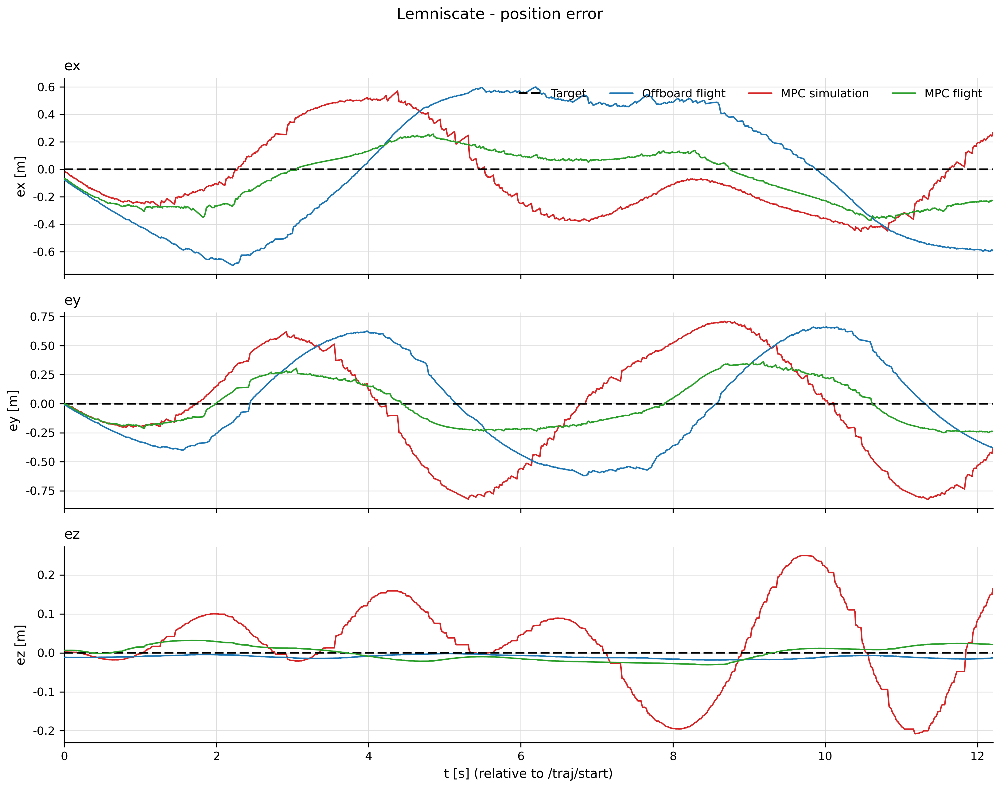

**图 10-9　8 字：位置误差–时间。** 场景：8 字；窗口：表 10-1 的 8 字公共窗。来源与生成命令同图 10-7。

悬停误差在厘米级；正方形与 8 字大一个量级，运动场景的逐点误差主要是**时间上的跟随滞后**，不是空间形状走错。

<big>**一句话总结：悬停误差在厘米级；正方形与 8 字的误差主要是匀速段的时间滞后，拐角处出现尖峰。**</big>

### 10.4.2 位置指标与悬停稳态

表 10-3 给出逐轴 RMSE、水平均值/最大值、垂直绝对值均值/最大值；逐轴 RMSE 与水平均值不可互换。

**表 10-3　位置误差指标（实际 − 目标，公共窗）**

<!-- BEGIN phase5-metrics:position -->
| 场景 | 源 | RMSE ex (m) | RMSE ey (m) | RMSE ez (m) | 水平均值 (m) | 水平最大 (m) | 垂直均值 (m) | 垂直最大 (m) |
|---|---|---|---|---|---|---|---|---|
| 悬停 | offboard | 0.0791 | 0.0730 | 0.0042 | 0.1047 | 0.1610 | 0.0032 | 0.0119 |
| 悬停 | mpc_sim | 0.0144 | 0.0056 | 0.0007 | 0.0132 | 0.0415 | 0.0004 | 0.0042 |
| 悬停 | mpc_real | 0.0618 | 0.0407 | 0.0067 | 0.0694 | 0.1333 | 0.0051 | 0.0189 |
| 正方形 | offboard | 0.4214 | 0.4069 | 0.0121 | 0.5720 | 0.7608 | 0.0117 | 0.0183 |
| 正方形 | mpc_sim | 0.3498 | 0.2646 | 0.0534 | 0.4073 | 0.6253 | 0.0403 | 0.1212 |
| 正方形 | mpc_real | 0.2133 | 0.1833 | 0.0156 | 0.2753 | 0.3802 | 0.0124 | 0.0390 |
| 8 字 | offboard | 0.4485 | 0.4080 | 0.0115 | 0.5935 | 0.8241 | 0.0107 | 0.0185 |
| 8 字 | mpc_sim | 0.2918 | 0.4724 | 0.1112 | 0.5204 | 0.8650 | 0.0868 | 0.2495 |
| 8 字 | mpc_real | 0.1962 | 0.1977 | 0.0188 | 0.2691 | 0.3950 | 0.0167 | 0.0317 |
<!-- END phase5-metrics:position -->

表注：窗口为表 10-1 的公共窗；单位 m；所有源在同一张 100 Hz 网格、各自轨迹原点相对系上逐点相减。完成时刻见表 10-1。

表 10-4 只列悬停公共窗最后 10 s（29.65–39.65 s）的稳态指标。只有悬停的目标是定点，运动场景末 10 s 不构成稳态；悬停包被截断，这 10 s 不是 60 s 悬停的末段。

**表 10-4　悬停末 10 s 稳态误差**

<!-- BEGIN phase5-metrics:hover-steady -->
| 源 | 水平均值 (m) | 水平最大 (m) | 垂直绝对值均值 (m) | 网格点 |
|---|---|---|---|---|
| offboard | 0.1194 | 0.1610 | 0.0037 | 1001 |
| mpc_sim | 0.0160 | 0.0313 | 0.0003 | 1001 |
| mpc_real | 0.1024 | 0.1333 | 0.0035 | 1001 |
<!-- END phase5-metrics:hover-steady -->

表注：窗口为公共窗最后 10 s；水平取 xy 范数，垂直取绝对值；单位 m。

<big>**一句话总结：逐轴 RMSE 与水平均值回答不同问题；悬停末十秒的稳态误差单独列表，且不是六十秒悬停的末段。**</big>

---

## 10.5 控制量（C1–C3）

控制量图四行：推力与 `wx`、`wy`、`wz`，只画模型预测控制仿真与实飞。offboard 发的是 `/mavros/setpoint_raw/local` 位置设定点，与推力/角速率不是同一层，混画会造成“看起来可比”的假象；两组只在位置跟踪上可比（10.6.1）。推力 N 值 = 归一化推力 × `t_max`，逐趟读取；CSV 按 100 Hz 零阶保持取样。

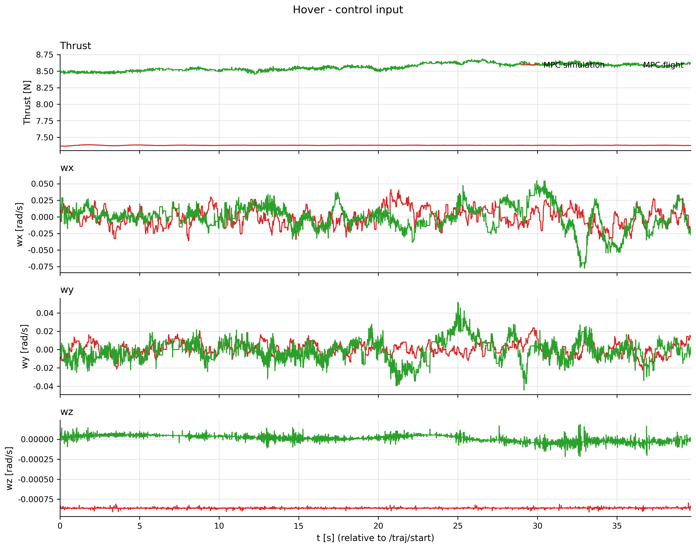

**图 10-10　悬停：控制量。** 场景：悬停；窗口：表 10-1 的悬停公共窗。来源：仿真为 SITL 求解指令，实飞为 `bag/6_free__20261017-070103` 的 `/mavros/setpoint_raw/attitude`（`body_rate` + `thrust`）。生成：`python3 tools/report/plot_control.py --scene all`。

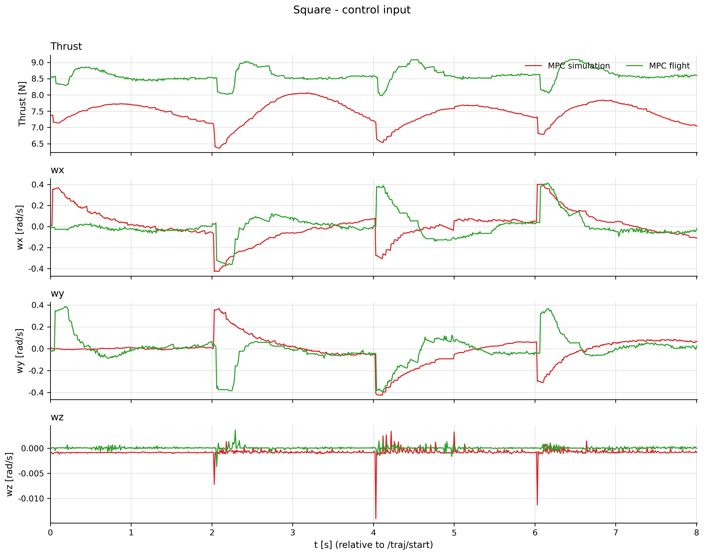

**图 10-11　正方形：控制量。** 场景：正方形；窗口：表 10-1 的正方形公共窗。来源与生成命令同图 10-10。

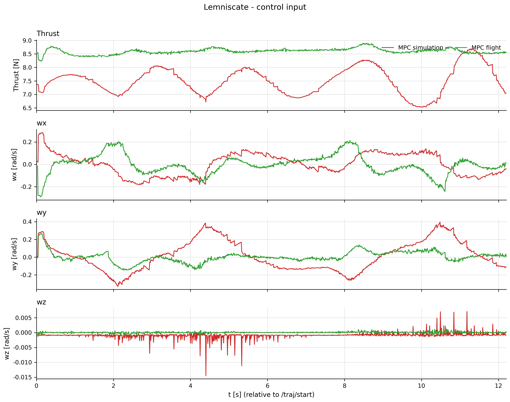

**图 10-12　8 字：控制量。** 场景：8 字；窗口：表 10-1 的 8 字公共窗。来源与生成命令同图 10-10。

悬停推力近乎直线，角速率很小；运动场景在拐角处出现台阶或凹陷，`wx`、`wy` 换向时到每秒零点几弧度，`wz` 全程很小。实飞推力均值高于仿真，数值见表 10-5。

**表 10-5　控制量统计（仅模型预测控制两源）**

<!-- BEGIN phase5-metrics:control -->
| 场景 | 源 | 推力均值 (N) | 推力最小 (N) | 推力最大 (N) | 角速率模长均值 (rad/s) | 角速率模长最大 (rad/s) | \|wx\|max (rad/s) | \|wy\|max (rad/s) | \|wz\|max (rad/s) | 饱和拍数 |
|---|---|---|---|---|---|---|---|---|---|---|
| 悬停 | mpc_sim | 7.378 | 7.364 | 7.388 | 0.0132 | 0.0416 | 0.0413 | 0.0238 | 0.0009 | 0 |
| 悬停 | mpc_real | 8.561 | 8.451 | 8.687 | 0.0185 | 0.0811 | 0.0774 | 0.0513 | 0.0002 | 0 |
| 正方形 | mpc_sim | 7.451 | 6.366 | 8.063 | 0.1357 | 0.5639 | 0.4292 | 0.4245 | 0.0140 | 0 |
| 正方形 | mpc_real | 8.601 | 7.977 | 9.089 | 0.1151 | 0.5511 | 0.4137 | 0.3910 | 0.0037 | 0 |
| 8 字 | mpc_sim | 7.513 | 6.523 | 8.693 | 0.1763 | 0.4227 | 0.2847 | 0.3964 | 0.0145 | 0 |
| 8 字 | mpc_real | 8.598 | 8.229 | 8.901 | 0.0821 | 0.3914 | 0.2895 | 0.2679 | 0.0022 | 0 |
<!-- END phase5-metrics:control -->

表注：窗口为表 10-1 的公共窗；推力单位 N，角速率单位 rad/s（FLU，机体系）。饱和拍数按生产判据：推力界 `[0, f_max]`，roll/pitch 3.84、yaw 6.28 rad/s，相对容差 1e-3。仿真的饱和拍数取自 `solver-summary.json` 的 `saturation.frames_with_sat`；实飞在 100 Hz 网格上逐拍套同一判据。两种计数都以“拍”为单位，不是秒。

表 10-5 的饱和拍数全为 0：三场里没有一拍被推到约束边界，也不表示输出被后处理裁剪；节点不做裁剪。

<big>**一句话总结：控制量图只比较模型预测控制的仿真与实飞，三场推力与角速率都没有顶到约束边界。**</big>

---

## 10.6 三组对比

### 10.6.1 offboard 与模型预测控制（位置层）

这一组只比位置跟踪。offboard 反馈 EKF 位置（约 30 Hz）、发位置设定点；模型预测控制实飞反馈原始动捕 `/mocap/pose_enu`、发推力与角速率。比较的是跟踪结果，不是控制器输入，也不能据此判断哪个控制器更强；差异同时含算法、反馈源与估计滞后，本批数据不能拆开。

表 10-3 的方向清楚：三场景里 offboard 的逐轴 RMSE、水平均值与最大值都高于模型预测控制实飞；垂直方向相反。即模型预测控制实飞水平更贴目标，offboard 高度更稳；这只是本批数据的方向，不带阈值。悬停末 10 s 稳态同向；正方形与 8 字末段仍在运动，没有稳态窗。

<big>**一句话总结：同一批包上，模型预测控制实飞的水平跟踪优于 offboard，高度误差更大；两组反馈源不同。**</big>

### 10.6.2 模型预测控制仿真与实飞

这一组同参考、同公共窗、同网格，最接近“只换被控对象与反馈源”。仍有两处不同：仿真状态来自 SITL 合成动捕 `x0`，实飞来自真实动捕经 VP；仿真时间是 SITL 自己的时间线。

读数与“仿真应更准”的直觉不一致：悬停时仿真误差更小；正方形与 8 字时仿真的水平与垂直误差反而更大，偏航差整场约 90°。不能据此说“实飞控制器优于仿真”：被控对象、状态源与时间对齐都不同，误差里混着模型失配、反馈源差异与时间滞后。本章只报读数，不判定原因；仿真的拐角外扩与 10.2 的轨迹图一致，偏航 90° 的未判定原因见 10.3。

<big>**一句话总结：悬停时仿真更准，运动场景时仿真的水平与垂直误差反而更大；本章只报读数，不判定原因。**</big>

### 10.6.3 求解耗时与退化

表 10-6 给出三趟标称 SITL 的稳态求解耗时、退化与饱和拍数；稳态统计去掉 `fallback == 'warmup'` 的拍。均值与 p95 回答常态，最坏回答单拍尖峰。

**表 10-6　标称 SITL 求解耗时与退化**

<!-- BEGIN phase5-metrics:solver -->
| 场景 | 稳态求解拍数 | 均值 (ms) | p95 (ms) | 最坏 (ms) | 退化拍数 | 饱和拍数 |
|---|---|---|---|---|---|---|
| 悬停 | 7792 | 3.126 | 3.624 | 20.138 | 0 | 0 |
| 正方形 | 5674 | 2.983 | 3.312 | 6.462 | 0 | 0 |
| 8 字 | 6567 | 3.132 | 3.612 | 10.738 | 0 | 0 |
<!-- END phase5-metrics:solver -->

表注：每场的数据来自 `tools/report/evidence/sitl/<tag>/solver-summary.json`；`稳态求解拍数` 是去掉 warmup 后的拍数；p95 用最近秩；退化拍数来自原始 DUT JSONL 的 `degraded` 字段，饱和拍数来自 `sat` 字段。耗时是 SITL 宿主机的读数，不是飞控上的读数。

三场均值与 p95 都在数毫秒，退化与饱和拍数为 0。最坏值要带限定读：正方形已在空闲时重跑；悬停与 8 字保留首轮读数，首轮与本机全量测试同时跑，可能被负载抬高。退化判的是解的质量与约束越界，不是耗时，“退化 0”不等于每拍都在 10 ms 内解完。

<big>**一句话总结：三场求解均值与 p95 都在数毫秒，退化与饱和均为零；悬停与八字的最坏值可能受本机负载影响。**</big>

---

## 10.7 边界与未验证项

### 10.7.1 五张 `wontfix` 票的缺口

五张票由操作者裁定收口为 `wontfix`——是“裁定收、不做了”，不是“做完了”；下列缺口没有证据作锚，本章不写成已解决。

- **phase4/01 台架几何与外参**：动捕刚体到 IMU 的 xy 外参未测（节点落 0.0），“动捕 z = 0 平面即地面”未证，`EKF2_EV_POS_*` / `EKF2_IMU_POS_*` 未上机读回，倾斜段实飞判据未跑。
- **phase4/04 固件重编重刷**：按操作者裁定不重刷，沿用现行固件与参数；无重编、重刷，也无刷前/刷后参数 diff。这是决定不做，不是验证通过。
- **phase4/09 阶梯 1+2**：阶梯 2 判据 ② 判不了、④ 水平红（最后撞地）；阶梯 1 第 4 框只落一半；同日操作者决定跳过阶梯 2 直接做闭环。
- **phase4/14 起链前控制器选择**：被 phase4/15 取代后收口；菜单 9 的模型预测控制档改为 `traj → mpc → control`，`control` 成为唯一任务总管。
- **phase4/16 阶梯 3/4 收尾缺口**：τ 实飞 A/B 未做，冻结值未上实飞；回退能力未触发、未取证；两级共同日志项缺失（无 `/mpc/*`、无逐拍求解耗时/内部状态/饱和标志）。

<big>**一句话总结：五张 wontfix 票的缺口都是“裁定收、不做了”，没有任何一条被本章或本轮数据补上。**</big>

### 10.7.2 本轮读数的边界

以下限制读表时要一并带上。

- **悬停 offboard 包录制截断**：只录到参考流末尾，`progress` 终值 0.661；所有指标只到公共窗右端，末段未进图或表。
- **仿真完成时刻不是墙钟**：仿真按参考 `span` 回放，完成时刻只在 SITL 时间线上成立；表 10-1 的仿真列不能与实飞列相减。
- **仿真偏航约 90°**：从首帧起就在 90° 附近、整场未转到 0；是数据读数，原因尚未判定，不要扣掉后再比较姿态。
- **VP 与 EKF 的 +0.03 rad 滚转零偏**：实飞姿态取 VP，与 30 Hz EKF 有约 +0.03 rad 系统差；实飞 roll 均值不在 0 主要是这个零点差，不是跟踪误差。
- **反馈源不同**：offboard 用 EKF 位置，模型预测控制实飞用原始动捕；比较的是跟踪结果，不是控制器输入。
- **求解最坏值可能受负载影响**：悬停与 8 字保留首轮读数，首轮与本机全量测试同时跑；正方形已在空闲时重跑。均值与 p95 影响较小，最坏值按此前提读。
- **起飞段欠阻尼**：三趟标称 SITL 都在离地后冲到目标高度以上再回落，约十几秒收敛；公共窗包含这段瞬态，悬停稳态不受影响，运动场景早期误差会受影响。
- **正方形此前从未在 SITL 跑过**：`R-square` 是本轮补上的第一趟，历史上 B 档判据曾把它删掉；本章读数只代表这一趟 nominal。

<big>**一句话总结：悬停被截断、仿真时间线独立、偏航九十度与滚转零点差都限制读法；最坏求解耗时可能含本机负载。**</big>

### 10.7.3 未验证项与不作外推的部分

- **τ 的实飞 A/B 未做**：四趟实飞都用节点默认 τ，冻结值未上实飞；“换 τ 更好或更坏”在本轮没有证据。
- **回退能力未在实飞中取证**：四趟实飞都未触发回退，phase4/08 的演练不能当本轮证据。
- **Tier A 与 Tier B 的 T0 失配证据不进入四源图**：参考或被控对象与实飞不同，放进来会把“失配鲁棒性”混进“同口径跟踪”。Tier A 的 ±30% 扫描读数出自被控对象重搭之前，`docs/control/mismatch-sweep.md` 页首已整页标作废；本章不引用。B 档矩阵见 `docs/control/tier-b-sitl-seam3.md`，回答的是另一个问题。
- **不把“没有异常”写成“已通过”**：饱和与退化计数为 0 只说明这三趟 nominal 没触发，不覆盖失配、外扰、电池变化或更长飞行。
- **不做跨层级比较**：offboard 与模型预测控制的控制量不可比；本章没有把位置设定点换算成推力或角速率，也没有反过来做。

<big>**一句话总结：τ 的 A/B、实飞回退与失配鲁棒性都未取证；三场 nominal 的“零饱和、零退化”不能外推。**</big>

---

## 10.8 小结

三个场景 × 四个源的图与表已齐。位置层模型预测控制实飞水平更优、offboard 高度更稳；姿态层实飞机头基本保持，仿真偏航约 90°；控制量只有模型预测控制两源可比，三场无饱和、无退化。仿真在运动场景的误差反而更大，本章只报读数、不判因。

边界：悬停包录制截断、仿真时间线独立、VP/EKF 有 +0.03 rad 零点差、反馈源不同、最坏求解值可能受负载影响；τ 的实飞 A/B、回退能力、失配鲁棒性均未取证，五张 `wontfix` 的缺口保持原样。没有统一阈值的地方，只给读数与未验证项。

<big>**一句话总结：四源三场景的图与指标已齐，水平跟踪与高度跟踪各有胜负；所有未取证项都单列，不作通过结论。**</big>
